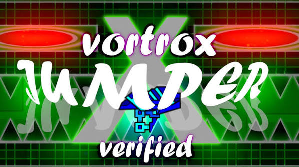
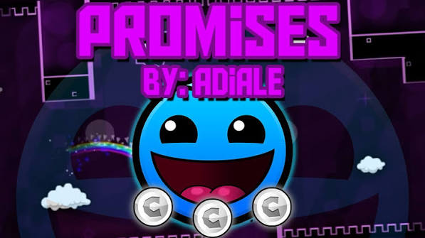
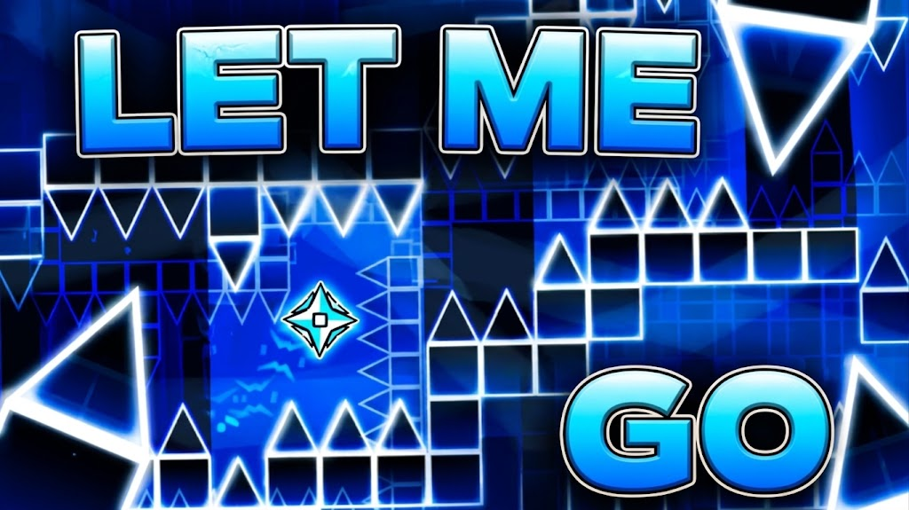
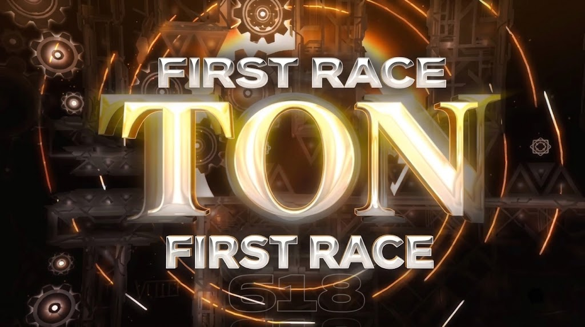
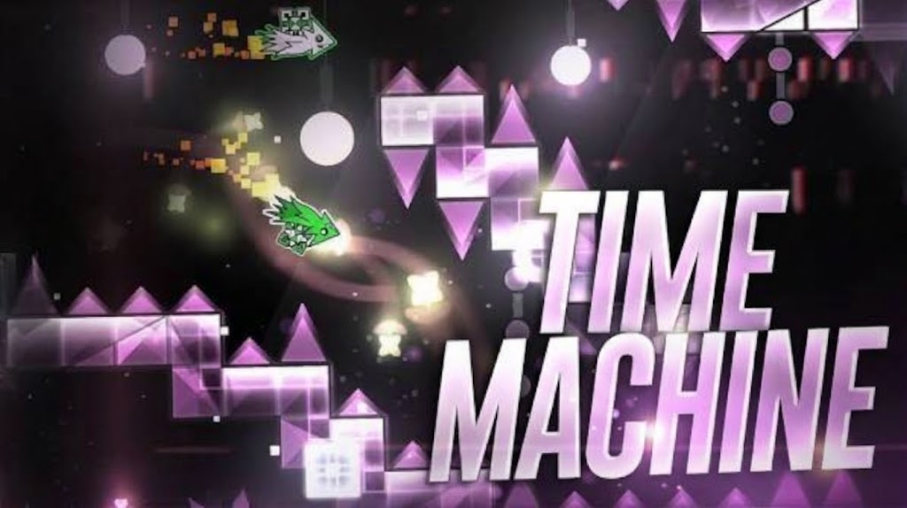

# Geometry Infinity

<p align="center">
  <a href="https://asafegamer05-glitch.github.io/Geometry-Infinity/">
    
  </a>
</p>

<p align="center">
  
  
  
  
  
  
</p>

**Geometry Infinity** is a single-player browser simulator inspired by the Geometry Dash Demonlist / Pointercrate. You play as a top GD player: verify levels, log your records, compete with simulated NPCs, complete challenges, and chase achievements across a 30-turn season. 🎮

> Geometry Infinity is not a Geometry Dash client and does not play levels for you. It is a fictional top-player journey simulator where you track your own real GD progress and watch the community rankings evolve around you. 🏁

---

## 📖 Table of Contents

- [What is Geometry Infinity?](#-what-is-geometry-infinity)
- [Features](#-features)
- [How to Play](#️-how-to-play)
- [Seasons](#-seasons)
- [Levels & Schedule](#-levels--schedule)
- [Challenges](#-challenges)
- [Scoring System](#-scoring-system)
- [Achievements](#-achievements)
- [Simulated Players (NPCs)](#-simulated-players-npcs)
- [Admin / Debug Panel](#️-admin--debug-panel)
- [Technical Architecture](#-technical-architecture)
- [File Structure](#-file-structure)
- [Run Locally](#-run-locally)
- [Customize](#-customize)
- [Saves & Privacy](#-saves--privacy)
- [Level Gallery](#️-level-gallery)
- [Developer Notes](#-developer-notes)
- [FAQ](#-faq)
- [Disclaimer](#️-disclaimer)

---

## 🌌 What is Geometry Infinity?

Geometry Infinity is a passion project made by a Geometry Dash fan (me, asafgamery 🇧🇷) who wanted to experience the feeling of being a top-tier GD player — the kind of player who verifies demons, races against other top players, and watches the demonlist evolve turn by turn.

The game simulates a full Geometry Dash season: new levels unlock, NPCs make progress or beat levels, special story events happen, and you log your own real records from actual GD. By the end of the season, a recap shows how your run went.

There are **2 seasons**, each with their own level schedule, challenges, lore events, and arc.

---

## ✨ Features

- 🗓️ **30-turn seasons** — levels unlock progressively according to a fixed schedule.
- 📈 **Manual record logging** — log your best percentage, attempt count, and completions yourself.
- 🏆 **Points system** — earn points for progress (51%+), completions, and low-attempt bonuses.
- 🤖 **20 simulated NPC players** — each with their own skill level, making the leaderboard feel alive.
- ⚡ **Challenges** — extra side tasks with their own point rewards, available at any time.
- ⭐ **Level verification** — verify a level before the NPC scheduled to verify it and choose your entry position.
- 📊 **Full stats viewer** — browse every player's profile, completed levels, scores, and trophies.
- 🏅 **9 achievements** — including two legendary rainbow achievements that are incredibly hard to get.
- ✨ **Custom levels** — create your own demon and add it to the list at any position.
- 🌍 **Event log** — every turn's story events (NPC completions, verifications, special moments) are recorded.
- 🎉 **Season recap** — a full end-of-season summary with your ranking, hardest level beaten, and highlights.
- 🛠️ **Admin panel** — a debug panel for testing everything without resetting the game.
- 💾 **LocalStorage saves** — no account, no server, no internet required. Your progress lives in your browser.
- 🌐 **Runs anywhere** — zero dependencies, zero build step. Open `index.html` and go.

---

## 🕹️ How to Play

1. Open [Geometry Infinity](https://asafegamer05-glitch.github.io/Geometry-Infinity/).
2. Enter your player name, pick a season (Season 1 or Season 2), and start.
3. Open Geometry Dash separately and play any levels currently visible in the tracker.
4. Return to Geometry Infinity and use **Log Progress** on a level card to enter:
   - Your best percentage reached.
   - Your total attempt count.
   - Check the completion box if you beat the level.
5. Use **Verify Level** on a level card to mark it as verified by you. If you're the first to verify (before any NPC), you get to choose the entry position: Top 1, Top 2, Top 3, or the scheduled target.
6. Take on **Challenges** in the Challenges tab for bonus points.
7. When done playing for the session, hit **Advance Turn** to progress the season.
8. At turn 30, the season ends and a full recap is shown.

> **Note:** Records are entered manually. The game trusts you completely. No attempt limits are enforced. Play honestly, or don't — it's your game. ✍️

---

## 📆 Seasons

### Season 1 — The Classic Arc

Season 1 follows the classic Geometry Dash progression: 7 original GD levels unlocking over 30 turns, plus 1 challenge. It's the introductory season designed to be chill and familiar. The levels start easy and get progressively harder as the season goes on.

**Season 1 ends with Jumper at the top of the list as the hardest demon.**

### Season 2 — The Infinity Arc

Season 2 is where things get serious. It starts with all 7 Season 1 levels already unlocked and verified, and over the next 30 turns introduces 15 brand-new demons plus 6 challenges. The levels are real Geometry Dash levels selected by the developer, including some iconic community creations.

**Season 2 ends with Let Me Go verified at Top 1 — the hardest level in Geometry Infinity.**

The season also features a hidden story arc: the **Alpha Trilogy** — Retray, Dark Paradise, and Sonar — three levels connected by lore. When all three are finally verified, a special event announces the trilogy's completion.

---

## 📅 Levels & Schedule

### Season 1 Levels

| Level | Unlock Turn | Target Position | Verifier NPC |
|---|---:|---:|---|
| Stereo Madness | 1 | #7 | Zoink |
| Back on Track | 5 | #6 | Doggie |
| Polargeist | 9 | #5 | SrGuillester |
| Dry Out | 13 | #4 | KrmaL |
| Base After Base | 17 | #3 | Cyclic |
| Can't Let Go | 21 | #2 | Trick |
| Jumper | 25 | #1 | SpaceUK |

> On turn 27, a special event moves **Can't Let Go** above **Jumper**, reshuffling the list. 🔥

### Season 2 New Demons

| Level | Unlock Turn | Target Position | GD ID |
|---|---:|---:|---|
| Promises | 1 | #3 | 26618473 |
| Retray Challenge | 2 | — | 6508283 |
| Amplification | 5 | #2 | 20635816 |
| Dark Paradise Challenge | 6 | — | 11280109 |
| Dream Land | 9 | #5 | 150245 |
| GoldenClub | 11 | #5 | 1446958 |
| Stereo Madness II | 13 | #2 | 72462399 |
| Let Me Go | 13 | #1 (final) | 151862414 |
| First Race | 17 | #4 | 27483789 |
| Flappy Hexagon Challenge | 17 | — | 1642022 |
| Time Machine | 22 | #2 | (official GD) |
| Stage IX Challenge | 20 | — | 977287 |
| Let Me Go *(verified)* | 25 | #1 | 151862414 |
| Sonar Challenge | 27 | — | 4454123 |

> 💡 Let Me Go is recommended to be played with the **NONG domsyeah remix** but it's not required.

---

## ⚡ Challenges

Challenges are side missions always available to complete. They don't unlock through turns — they're just there for extra points whenever you feel like it.

### Season 1 Challenges
- **Stereo Madness Challenge** — the classic intro challenge.

### Season 2 Challenges
- **Stereo Madness Challenge** (carried over from S1)
- **Retray Challenge** — unlocks turn 2
- **Dark Paradise Challenge** — unlocks turn 6
- **Flappy Hexagon Challenge** — unlocks turn 17
- **Stage IX Challenge** — unlocks turn 20
- **Sonar Challenge** — unlocks turn 27

Challenges award their own points separate from the main level scoring. A low-attempt bonus applies to challenges completed by the player.

---

## 💯 Scoring System

Points are earned in multiple ways:

### Progress Points
Reaching **51% or higher** on a level awards **50% of its base points**.

### Completion Points
Fully completing a level awards **100% of its base points** plus an attempt bonus:

| Attempts | Bonus |
|---|---|
| Under 100 | Very large bonus |
| 100–299 | Large bonus |
| 300–999 | Medium bonus |
| 1000+ | Small bonus |

### Challenge Points
Each challenge has its own flat point reward. Low-attempt completions earn a bonus on top.

### Verification Bonus
Verifying a level (being the first to complete it) gives additional points and places you in the event log as the verifier.

### Tiebreakers
If two players have the same score, the one with more completed levels ranks higher. This matters a lot in the mid-game when NPCs are catching up fast.

---

## 🏅 Achievements

There are **9 achievements** to unlock. Two of them are rainbow-tier and extremely rare.

| Achievement | How to unlock |
|---|---|
| 🌟 First Victor | Be the first to verify any Top 1 level |
| 🎯 Verify a Top 1 | Verify any level that enters at Top 1 |
| 🔥 Demon Slayer | Complete the 3 hardest levels in the current list |
| 👶 First Step | Complete your very first level |
| ⚡ Challenge Starter | Complete your first challenge |
| 🏋️ Challenge Grinder | Complete 3 challenges |
| 🌈 **Challenge God** *(rainbow)* | Complete **all** challenges |
| 🍀 Alpha Trilogy | Complete all 3 Alpha Trilogy levels (Retray, Dark Paradise, Sonar) |
| 👑 **Geometry Infinity** *(rainbow + animated)* | Complete **all** levels in the game |

> The **Geometry Infinity** achievement is the hardest thing to unlock in the entire game. It requires completing every single level across the season. Its icon has a full rainbow gradient AND an animation that plays when it shows up.

Achievement icons are displayed:
- In the **profile sidebar** as small badge icons
- In the **Stats Viewer** player profile as large labeled pills
- In the **Achievements tab** as full cards

---

## 🤖 Simulated Players (NPCs)

The ranking features **20 simulated NPC players**, each with:
- A **skill value** that determines how fast they progress and how often they complete levels.
- A **completed array** tracking which levels they've beaten.
- **Turn-by-turn progress** that updates every time you advance.

NPCs compete with each other and with you. Some are strong (Zoink, Doggie, SpaceUK) and others are weaker but still score points. The result is a leaderboard that feels genuinely dynamic.

NPCs can:
- Make progress on a level (increase their %)
- Complete a level (add it to their list and score points)
- Verify a level on its scheduled turn (if no one verified it first)
- Complete challenges with a random chance each turn

> If **you** verify a level before the scheduled NPC, the NPC never becomes the official verifier. You take the glory. 👑

---

## 🛠️ Admin / Debug Panel

There's a hidden (not actualy hidden) **Admin Panel** accessible from the header (🛠️ Admin button). It's meant for testing things without having to play through 30 turns manually.

Available actions:

| Button | What it does |
|---|---|
| Jump to Turn N | Set the current turn to any value |
| Beat All Levels | Mark all visible levels as completed |
| Beat Current Top 1 | Complete just the #1 level |
| Beat Current Top 3 | Complete the top 3 levels |
| Beat All Challenges | Complete every challenge |
| Beat Alpha Trilogy | Complete Retray, Dark Paradise, and Sonar |
| Unlock All Achievements | Grant every achievement instantly |
| Reset Achievements | Revoke all achievements |
| Add Score | Add a custom amount of bonus points |

> The admin panel was added late in development after I got tired of replaying from scratch every time I needed to test something at turn 25. 😅

---

## 🏗️ Technical Architecture

Geometry Infinity is built with **zero external dependencies** — no React, no Vue, no npm, no build tools. Just pure vanilla HTML, CSS, and JavaScript.

### How the Engine Works

```
┌─────────────────────────────────────────────────────────┐
│                    gameState (object)                    │
│  - currentTurn        - playerLevels                    │
│  - nick / season      - npcs                            │
│  - achievements       - eventLog                        │
│  - levelRanks         - adminBonusScore                 │
│                       - gameOver                        │
└──────────────────────────┬──────────────────────────────┘
                           │ saved to / loaded from
                    localStorage
```

**State:** Everything is one big `gameState` object. It serializes to JSON and saves to `localStorage` automatically.

**Turns:** `advanceTurn(state)` is called when the player clicks Advance Turn. It:
1. Increments `currentTurn`
2. Unlocks new levels from the schedule
3. Runs NPC progress/completion rolls
4. Triggers scheduled verifications and special events
5. Returns an event log for the turn modal

**Ranking:** Every visible level has a numeric rank in `state.levelRanks`. Higher = harder = #1. `insertLevelAtPosition(state, levelId, pos)` re-ranks ALL visible levels in one pass whenever a new one enters.

**Rendering:** There's no virtual DOM. `renderAll()` rebuilds innerHTML from scratch. It's simple and works fine given the page size.

**Achievements:** `checkAchievements(state)` runs after every significant action and sets `state.achievements[id] = true` for each unlocked achievement.

**NPCs:** Each NPC rolls dice every turn based on their skill value. If the roll is high enough, they complete a level. Otherwise they make progress.

---

## 📁 File Structure

```text
geometryInfinity/
├── index.html          ← Start screen (name input, season select)
├── game.html           ← Main game page (all tabs, modals, header)
├── game.js             ← All game logic (~2900+ lines of vanilla JS)
├── style.css           ← All styles (~1700+ lines of vanilla CSS)
├── level_ids.txt       ← Mapping of level names to GD in-game IDs
├── README.md           ← You are here
└── assets/
    └── levels/
        ├── stereo_madness.jpg
        ├── back_on_track.jpg
        ├── polargeist.jpg
        ├── dry_out.jpg
        ├── base_after_base.jpg
        ├── cant_let_go.jpg
        ├── jumper.jpg
        ├── promises.jpg
        ├── amplification.jpg
        ├── dream_land.jpg
        ├── goldenclub.jpg
        ├── stereo_madness_ii.jpg
        ├── let_me_go.jpg
        ├── first_race.jpg
        ├── time_machine.jpg
        └── README.md   ← Thumbnail naming guide
```

> `game.js` is the entire game brain. It's big (~2900 lines), but every section is clearly annotated with `asafgamery:` comments explaining what each part does.

---

## 💻 Run Locally

Clone or download the repository and open `index.html` in a browser. For best results (especially for `level_ids.txt` loading), serve locally:

**VS Code — Live Server extension:**
Right-click `index.html` → Open with Live Server

**Python (built-in server):**
```bash
cd geometryInfinity
python -m http.server 8000
# then open http://localhost:8000
```

**Node.js:**
```bash
npx serve .
```

No `npm install` needed. No build step. No `.env` files. Just open it.

---

## 🎨 Customize

### Add or change levels
Edit the `GI.SEASON_1_LEVELS` or `GI.SEASON_2_LEVELS` arrays near the top of `game.js`. Each level has:
- `id` — internal identifier (lowercase, underscores)
- `name` — display name
- `rank` — initial sort rank
- `unlockTurn` — which turn it becomes available
- `targetPos` — where it enters the ranked list
- `verifier` — which NPC officially verifies it
- `inGameId` — Geometry Dash in-game ID (optional, shown in Verify modal)
- `basePoints` — points for 51% and 100% completion

### Add level IDs
Edit `level_ids.txt` with entries like:
```
Level Name: 123456789
```
Or set them directly in `GI.LEVEL_IDS` in `game.js`.

### Add thumbnails
Drop a `.jpg`, `.png`, or `.jpeg` file into `assets/levels/` named after the level's internal ID (e.g. `stereo_madness.jpg`). The game finds it automatically.

### Add NPCs
Edit the `GI.NPCS` array in `game.js`. Each NPC has a `name` and a `skill` value (0–1).

### Change scoring
Edit the base points on each level and the bonus tiers in the `getPlayerScore()` function.

### Change the visual style
All CSS variables (colors, fonts, spacing) are defined at the top of `style.css` in the `:root` block. The design is inspired by [Pointercrate](https://pointercrate.com/).

---

## 🔒 Saves & Privacy

Progress is stored in `localStorage` under the key `geometry_infinity_save`.

- It does **not** sync between devices or browsers.
- It does **not** send any data to any server.
- It does **not** connect to Geometry Dash in any way.
- It may be lost if you clear your browser's site data.

To reset, use the **Reset Progress** option in the game, or clear `localStorage` manually in browser DevTools.

---

## 🖼️ Level Gallery

<table>
  <tr>
    <td align="center"><br><strong>Stereo Madness</strong></td>
    <td align="center"><br><strong>Back on Track</strong></td>
    <td align="center"><br><strong>Polargeist</strong></td>
  </tr>
  <tr>
    <td align="center"><br><strong>Dry Out</strong></td>
    <td align="center"><br><strong>Base After Base</strong></td>
    <td align="center"><br><strong>Can't Let Go</strong></td>
  </tr>
  <tr>
    <td align="center"><br><strong>Jumper</strong></td>
    <td align="center"><br><strong>Promises</strong></td>
    <td align="center"><br><strong>Amplification</strong></td>
  </tr>
  <tr>
    <td align="center"><br><strong>Let Me Go</strong></td>
    <td align="center"><br><strong>First Race</strong></td>
    <td align="center"><br><strong>Time Machine</strong></td>
  </tr>
</table>

---

## 👨‍💻 Developer Notes

> *These are personal notes from me, asafgamery. I wanted to keep them in the README as an honest look at how this project was built.*

---

### Why I made this

I love Geometry Dash. Like, genuinely — it's one of those games that just stuck with me for years. The community, the music, the insane skill ceiling, the demonlist culture... all of it. I always thought it would be cool to simulate the experience of being a top player without actually having to be a top player (because I'm definitely not 😅).

So I built Geometry Infinity. It started as a small idea and slowly turned into something much bigger than I expected.

---

### How long it took

**About 2 weeks**, working on it in my free time. I'm a Brazilian dev and not super experienced — I've built some stuff before but nothing this complex. A lot of the time was spent on:

- Figuring out how to make the ranking system work correctly (turns out re-ranking everything from scratch every time is simpler than trying to maintain order incrementally)
- Making the NPC simulation feel natural and not too predictable
- Building Season 2's entire level schedule and finding good levels that fit the vibe
- CSS. So much CSS. The Pointercrate-inspired layout took forever to get right.
- Bug fixing things I didn't even know were broken until I tested them

---

### Things I'm proud of

- **The ranking engine.** `insertLevelAtPosition()` is elegant. It takes every visible level, removes the target, inserts it at the right spot, and re-ranks everything cleanly. Simple and it just works.
- **Season 2's level selection.** I spent a long time finding levels that fit each turn's vibe. Some of them are really obscure GD levels that I love.
- **The Alpha Trilogy arc.** Retray, Dark Paradise, and Sonar all being connected by lore, with a special event when the trilogy is completed at turn 27, is my favorite storytelling moment in the game.
- **The Achievements system.** Especially the two rainbow ones — Challenge God and Geometry Infinity. The legendary badge animation for completing all levels took way too long to implement but it was worth it.
- **The Admin Panel.** Added it late but it saved me SO much testing time. If you're ever debugging anything in this game, use it.

---

### Things I struggled with

- **The verify flow** — deciding who gets to verify first (player vs NPC) and what position they get was the most confusing part of the logic to design. I rewrote it a few times.
- **LocalStorage edge cases** — sometimes old saves would break when I added new fields to `gameState`. I had to add migration logic.
- **CSS specificity wars** — `style.css` has gotten long. Some rules fight each other in ways I didn't expect. If something looks wrong, it's probably a specificity issue.
- **The rainbow SVGs** — getting gradient SVG icons to show correctly in multiple places (profile sidebar, stats viewer, achievements tab) without duplicate gradient IDs breaking things was surprisingly annoying.

---

### Design inspiration

The visual design is inspired by [Pointercrate.com](https://pointercrate.com/), which is the real Geometry Dash Demonlist website. I wanted the game to feel like you were actually browsing a GD top-player site, not just a generic game tracker.

The color palette uses a light-mode card layout with accent blues and reds that match Pointercrate's style.

---

### On the codebase

`game.js` is a single file with ~2,900 lines. I know that sounds scary but it's well organized:

- Every section is separated by `// ─────` divider comments
- Every comment is prefixed with `asafgamery:` so you know I wrote it and what it's about
- Functions are grouped by what they do (state, rendering, NPC logic, achievements, admin, etc.)
- There's a giant header comment at the top that explains the entire engine

No build tool, no bundler, no TypeScript. Just a file you can open in any text editor and read top to bottom.

One fun easter egg: somewhere in the code there's a variable called `somethingilikelol67`. It's a totally normal variable that just got a cursed name. It works perfectly fine. 😂

---

### Note on level IDs

The `level_ids.txt` file contains the Geometry Dash in-game IDs for levels that have them. These are used to show the GD ID in the Verify modal so you know exactly which level to search for in GD. Original GD levels (Stereo Madness, Jumper, etc.) don't have IDs since they're built into the game — they show "Official Level" instead.

---

### If you want to contribute

Feel free to fork the repo and play around. If you find a bug or want to suggest something, open an issue. This is a solo fan project so contributions aren't expected but are always welcome.

If you want to add new levels for a Season 3 or beyond — go for it. The level schedule system is designed to be easy to extend. Just add entries to the right array in `game.js` following the existing format.

---

## ❓ FAQ

**Q: Does this connect to Geometry Dash in any way?**
A: No. It doesn't read from GD, talk to any API, or verify your in-game records. You enter everything manually.

**Q: Can I play Season 2 without playing Season 1?**
A: Yes. Season 2 starts with all Season 1 levels already completed and unlocked.

**Q: What if my save gets corrupted?**
A: Use Reset Progress from the main menu, or manually clear `geometry_infinity_save` from your browser's localStorage in DevTools.

**Q: Can I have multiple saves?**
A: Not natively. The game uses one `localStorage` key. You could manually export/import the JSON if you want to manage multiple saves.

**Q: Why is there a variable called `somethingilikelol67`?**
A: Because I thought it was funny. It's just a normal variable with a cursed name. It works perfectly.

**Q: Why no dark mode?**
A: I wanted to match Pointercrate's default look, which is light mode. Maybe someday.

**Q: What's the Alpha Trilogy?**
A: Retray, Dark Paradise, and Sonar — three Season 2 challenges connected by a secret lore arc. When all three are verified, a special event at turn 27 announces that the trilogy is complete.

**Q: What's the hardest achievement?**
A: **Geometry Infinity** — completing every single level in the game. It has a rainbow + animated badge and is intentionally almost impossible to get in a single season run.

---

## ⚠️ Disclaimer

Geometry Infinity is a **fan-made project** and is not affiliated with RobTop Games or the creators of Geometry Dash. Geometry Dash and its trademarks belong to their respective owners. Level names, images, and IDs included in this project are used for fan/educational purposes only as visual references for the tracker.

The NPC player names used in the simulation are inspired by well-known GD community names but are used purely as fictional simulation characters. No real player data is used or implied.

---

<p align="center">
  <a href="https://asafegamer05-glitch.github.io/Geometry-Infinity/">
    
  </a>
</p>

<p align="center">
  Made with lots of ❤️ and way too many late nights by <strong>asafgamery</strong> 🇧🇷
</p>
