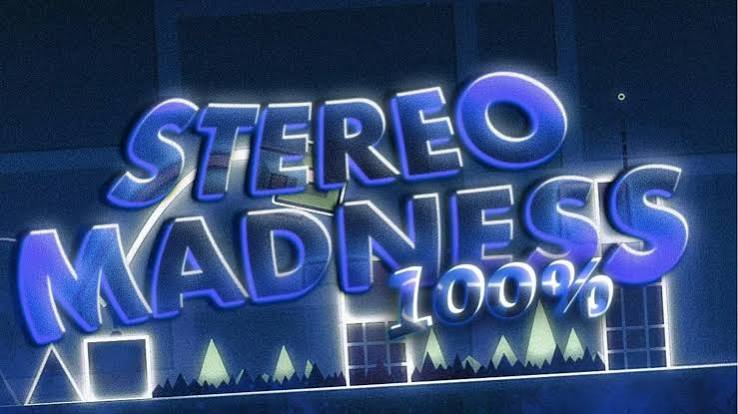
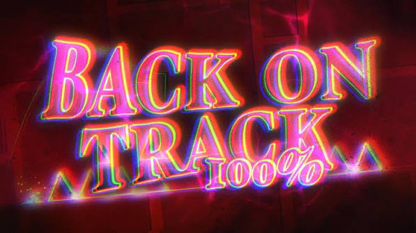
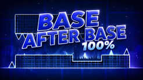

# Geometry Infinity

<p align="center">
  <a href="https://asafegamer05-glitch.github.io/Geometry-Infinity/">
    
  </a>
</p>

<p align="center">
  
  
  
</p>

**Geometry Infinity** is a single-player progress tracker inspired by Geometry Dash difficulty lists. Start a season, play levels in your own copy of Geometry Dash, then come back and log your records, completions, and verifications. 🎮

> Geometry Infinity is not a Geometry Dash client and does not play levels for you. It is a fun, fictional top-player journey tracker. 🏁

## ✨ Features

- 🗓️ A 30-turn season with levels unlocking over time.
- 📈 Manually log your best percentage, attempts, and completions.
- 🏆 Earn points for progress, completions, and low-attempt runs.
- 🤖 Compete with simulated NPCs that progress each turn.
- ⚡ Take on extra challenges that are always available.
- ⭐ Verify an upcoming level early to add it to the list.
- 📊 Explore rankings, player profiles, turn events, and your season recap.
- 💾 Progress is saved locally in your browser. No account or game server required.

## 🖼️ Level Gallery

These are the level thumbnails included with the project and shown on the in-game cards.

<table>
  <tr>
    <td align="center"><br><strong>Stereo Madness</strong></td>
    <td align="center"><br><strong>Back on Track</strong></td>
    <td align="center"><br><strong>Polargeist</strong></td>
  </tr>
  <tr>
    <td align="center"><br><strong>Dry Out</strong></td>
    <td align="center"><br><strong>Base After Base</strong></td>
    <td align="center"><br><strong>Can't Let Go</strong></td>
  </tr>
</table>

## 🕹️ How to Play

1. Open [Geometry Infinity](https://asafegamer05-glitch.github.io/Geometry-Infinity/).
2. Enter your player name and start a new season.
3. Open Geometry Dash separately and play any levels currently available.
4. Return to the tracker and choose **Log Progress** to enter your best percentage and total attempts. Check the completion box when you beat a level.
5. When your session is over, advance the turn to update the schedule, NPCs, and events.
6. Follow the season through the rankings, player profiles, and **Season** tab.

Records are entered manually for a casual experience. The limit of 10 attempts per level per turn is a house rule for the fun of it; the website does not check or restrict attempts made in Geometry Dash. ✍️

## 📅 Levels & Season

| Level | Unlock turn | Base points |
|---|---:|---:|
| Stereo Madness | 1 | 50 |
| Back on Track | 5 | 110 |
| Polargeist | 9 | 200 |
| Dry Out | 13 | 320 |
| Base After Base | 17 | 470 |
| Can't Let Go | 21 | 660 |
| Jumper | 25 | 900 |

Levels are displayed from hardest to easiest. On turn 27, a special simulated event moves **Can't Let Go** above **Jumper** in the list. 🔥

### 💯 Scoring

- Reaching **51% or higher** awards half of a level's base points.
- Completing a level awards its full base points plus a bonus based on the recorded attempt count.
- Lower attempt counts earn larger bonuses, with different tiers below 100, 300, and 1,000 attempts.
- Challenges award extra points, with a possible low-attempt bonus for player completions.
- The ranking sorts players by score and uses completed levels as a tiebreaker.

## 🤖 Simulated Players

The ranking features 20 simulated players. Each NPC has a skill value that affects progress, level completion chances, and challenge completion chances. Their results are generated by the game and can vary from season to season.

These names are part of the simulation. The project does not access official results or connect to Geometry Dash.

## 🧰 Built With

- **HTML** for pages and dialogs.
- **CSS** for responsive layouts and visual components.
- **Vanilla JavaScript** for game rules, simulation, rankings, and persistence.
- **LocalStorage** to save progress in the current browser.

There is no build step and no npm dependency installation required.

## 💻 Run Locally

Clone or download the repository, then open `index.html` in a browser. For a more consistent experience, especially when loading `level_ids.txt`, serve the files locally with an extension such as Live Server in VS Code.

```text
geometryInfinity/
|-- index.html
|-- game.html
|-- game.js
|-- style.css
|-- level_ids.txt
`-- assets/
    `-- levels/
```

## 🎨 Customize

- **Levels, points, turns, NPCs, and challenges:** edit the constants near the top of `game.js`.
- **Level IDs:** add entries to `level_ids.txt` using `Level Name: ID`. IDs can also be set in `GI.LEVEL_IDS`.
- **Thumbnails:** add images to `assets/levels/` named after the level ID, such as `stereo_madness.jpg`. The game supports `.png`, `.jpg`, and `.jpeg`.
- **Visual style:** edit the variables and rules in `style.css`.

See [`assets/levels/README.md`](assets/levels/README.md) for more thumbnail details.

## 🔒 Saves & Privacy

Progress is stored in your browser's `localStorage` under the key `geometry_infinity_save`. It does not sync between browsers or devices and may be lost if you clear site data. Use **Reset Progress** to erase the current season; starting a new season also replaces the saved progress.

The project requires no account, does not send records to a server, and does not verify what happens inside Geometry Dash.

## 🚀 GitHub Pages

The **PLAY** badge at the top of this README links to this repository's GitHub Pages URL:

<p align="center">
  <a href="https://asafegamer05-glitch.github.io/Geometry-Infinity/">
    
  </a>
</p>

To publish the site, enable **Settings > Pages** and select the `main` branch and root folder (`/`) as the source. It may take a few minutes for the site to become available after publishing. 🌐

## ⚠️ Disclaimer

Geometry Infinity is a fan-made project and is not affiliated with RobTop Games or the creators of Geometry Dash. Geometry Dash and its trademarks belong to their respective owners. The level images included in this project are used as visual thumbnails for the tracker.

---

Made with lots of ❤️ by asafgamery